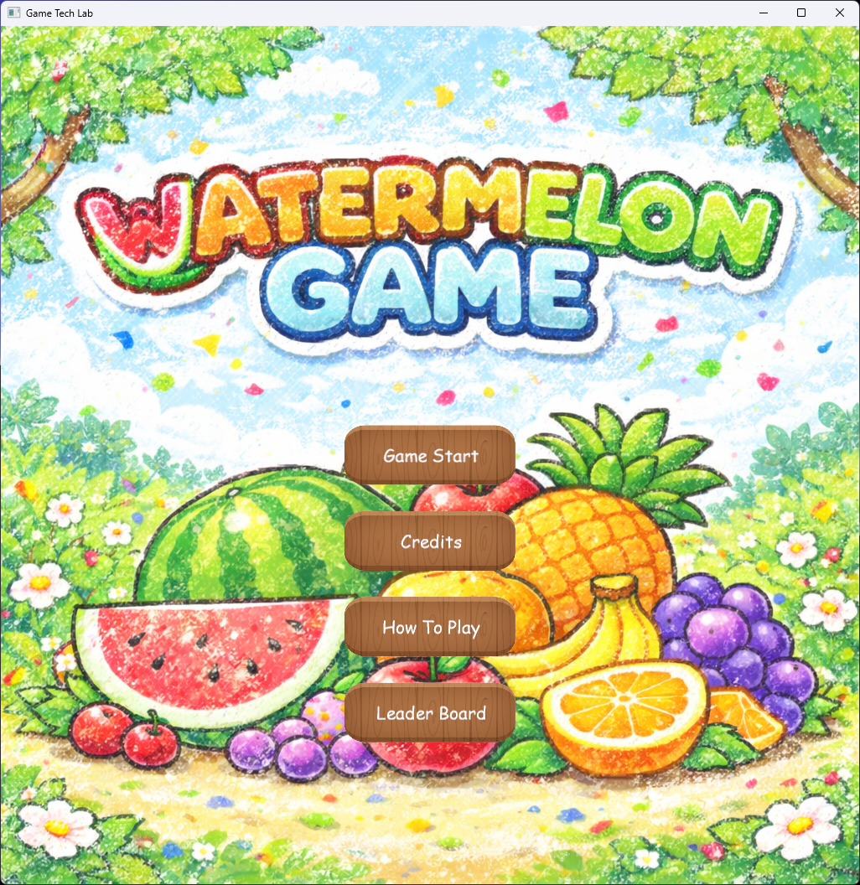

# 🍉 Week 01 — Watermelon Game

> DirectX 11 기반 공 물리 시뮬레이션을 과일 병합 퍼즐 게임으로 확장한 첫 번째 게임잼

## 프로젝트 정보

- 프로젝트명: Watermelon Game
- 기간: 2026.03.09. ~ 2026.03.12.
- 팀 구성: 4명
- 원본 저장소: [KraftonJungle_Week01_Team4](https://github.com/jskim-research/KraftonJungle_Week01_Team4) 🔒
- 개인 커밋 식별자: `CaptainTangerine`
- 공개 코드: [Source](Source/) · [Shaders](Shaders/)

## 프로젝트 개요

같은 종류의 과일을 충돌시켜 더 큰 과일로 합치고 점수를 얻는 퍼즐 게임입니다. 0주차의 공 물리 시뮬레이션을 바탕으로 과일 낙하와 병합, 점수와 리더보드, 게임 상태 전환, UI, 사운드, 파티클, 마우스와 게임패드 입력을 결합했습니다.

개발 기간이 나흘뿐인 게임잼이었기 때문에 각자 기능 브랜치에서 작업한 뒤 `main`을 자주 병합했습니다. 개인 기여는 커밋 메시지만 보지 않고 실제 변경 파일과 diff를 확인해 기능 단위로 정리했습니다.

## 미리보기

### 타이틀 화면



### 게임 플레이


## 팀 전체 구현

- 마우스 또는 게임패드로 낙하 위치를 정하고 과일 생성
- 같은 종류의 과일이 충돌하면 다음 단계 과일로 병합
- 과일 단계에 따른 점수 계산과 상위 점수 저장
- 타이틀, 게임 방법, 크레딧, 플레이, 게임 오버, 리더보드 화면 구성
- 게임 오버 라인과 위험 표시, 재시작과 타이틀 복귀
- 이미지·텍스트 위젯, 버튼, 다음 과일 및 현재 점수 UI
- FMOD 기반 BGM과 낙하·병합·버튼·승리·게임 오버 효과음
- XInput 기반 게임패드 입력과 미세 조작

## 개인 기여

### 충돌 물리와 마찰·회전

- 바닥 충돌 시 법선 충격량에 비례한 마찰 충격량을 계산해 수평 속도를 감쇠시켰습니다.
- 접선 방향 상대 속도, 관성 모멘트, 마찰 충격량을 이용해 선속도와 각속도를 함께 갱신했습니다.
- 과일 반지름의 제곱을 질량으로 사용하고, 작은 과일의 질량에 하한을 두어 작은 과일이 과도하게 튀는 현상을 완화했습니다.
- 반발 계수, 마찰 계수, 각속도 감쇠와 정지 임계값을 반복 조정했습니다.
- 겹침 보정에 허용 오차와 보정 비율을 적용하고 여러 차례 충돌을 반복 계산한 뒤 경계 안으로 다시 제한해 과일 더미의 떨림을 줄였습니다.

### 파티클 시스템과 오브젝트 풀

- 수명, 활성 상태, 이동 속도를 가진 파티클 객체를 만들었습니다.
- 생성·삭제 비용과 수명 관리를 단순화하기 위해 대기 큐와 활성 배열로 구성한 오브젝트 풀을 구현했습니다.
- 과일이 병합될 때 충돌 위치에서 여러 파티클을 방사하고, 수명이 끝난 파티클을 풀로 반환했습니다.
- 별 텍스처와 ease-out 이동을 적용하고 게임 재시작 시 활성 파티클을 모두 반납하도록 했습니다.

### FMOD 사운드 시스템

- FMOD 헤더·라이브러리와 빌드 후 DLL 복사 설정을 프로젝트에 연결했습니다.
- 경로별 사운드 캐시와 BGM·SFX 채널 그룹을 관리하는 사운드 매니저를 구현했습니다.
- BGM은 이전 채널을 정지하고 교체하며, SFX는 동시에 재생할 수 있도록 분리했습니다.
- 과일 낙하와 병합, 버튼 클릭, 수박 완성, 게임 오버에 효과음을 연결하고 상태 전환 시 BGM을 복구했습니다.

### 점수 UI와 버튼 프로토타입

- 현재 점수를 왼쪽 패널에 표시하고 병합 직후 텍스트가 갱신되도록 연결했습니다.
- 이미지 위젯을 확장한 버튼 프로토타입을 만들고 NDC 좌표를 화면 좌표로 변환해 마우스 hit test를 수행했습니다.
- 버튼 크기와 부모 위젯의 스케일을 반영하고, 버튼 클릭 시 공통 효과음을 재생하도록 확장했습니다.

### 그래픽·게임 객체 수명 관리

- Line vertex buffer, scene render target·SRV·texture, texture SRV, alpha blend state 등 Direct3D COM 객체의 해제 경로를 보완했습니다.
- 파티클 풀과 텍스처 객체를 종료·재시작 경로에서 정리했습니다.
- 게임 오버 후 배열과 파티클 상태를 함께 초기화해 재시작 크래시를 수정했습니다.

## 문제 해결

### 쌓인 과일이 계속 떨리는 문제

두 물체를 한 번만 밀어내면 다수의 과일이 동시에 맞닿은 상황에서 다른 충돌 때문에 다시 겹쳤습니다. 충돌 해소를 반복하고, 침투 깊이 전체를 즉시 보정하지 않도록 작은 허용 오차와 보정 비율을 적용했습니다. 보정 뒤에는 과일을 맵 경계 안으로 제한하고 작은 속도를 0으로 수렴시켰습니다.

### 각속도가 계속 커지는 문제

접선 마찰 충격량이 다중 접촉에서 반복 적용되면서 회전 에너지가 누적됐습니다. 각속도 감쇠를 강화하고 최대 각속도를 제한했으며, 접선 상대 속도와 법선 충격량이 충분한 경우에만 토크를 적용하도록 조건을 추가했습니다.

### 게임 오버 후 재시작 크래시

게임 오버 상태에서 기존 과일과 파티클의 소유권·활성 상태가 서로 다르게 남아 있었습니다. 컨테이너와 파티클 풀을 함께 초기화해 재시작 시 일관된 상태에서 시작하도록 수정했습니다.

### BGM과 효과음의 재생 방식 충돌

초기 구현은 채널 수가 제한되어 효과음을 재생할 때 기존 소리가 끊길 수 있었습니다. BGM과 SFX를 채널 그룹으로 나누고 재생 함수를 분리해 BGM 교체와 동시 효과음 재생을 각각 처리했습니다.

### 게임 종료 시 GPU 리소스 누수

생성한 COM 객체와 텍스처 중 일부가 종료 경로에서 해제되지 않았습니다. 객체별 해제 함수를 추가하고 포인터를 초기화했으며, 마지막 정리 단계에서 동적으로 생성한 UI 텍스처를 모두 삭제했습니다.

## 코드 아카이브

```text
week01/
├── README.md
├── NOTICE.md
├── Docs/         # 타이틀 화면과 플레이 미리보기
├── Source/       # 게임과 엔진 코드
└── Shaders/      # HLSL 셰이더
```

이 폴더의 코드는 프로젝트 결과와 구현 구조를 열람하기 위한 공개 아카이브입니다. 원본의 IDE 캐시, 빌드 산출물, 게임 실행용 사운드·이미지 에셋, FMOD와 기타 서드파티 파일은 포함하지 않았습니다.

현재 공개본만으로는 빌드하거나 실행할 수 없습니다. 실행 가능한 배포본이 아니라 소스 포트폴리오이며, 코드와 에셋의 공개 범위가 정리되면 별도의 빌드 구성을 추가할 수 있습니다.

## 기술 스택

- C++20
- DirectX 11, HLSL
- Dear ImGui
- DirectX Tool Kit for DirectX 11
- FMOD Engine
- XInput
- Visual Studio, MSBuild

## 회고

첫 주에는 물리 공식을 한 번 구현하는 것보다 여러 물체가 동시에 쌓일 때 안정적으로 보이게 만드는 일이 더 어려웠습니다. 마찰, 반발, 각속도, 침투 보정은 서로 영향을 주기 때문에 한 계수의 수정이 다른 불안정성을 만들기도 했습니다. 최초 구현 뒤 감쇠·임계값·질량·반복 횟수를 계속 조정하며 안정성을 높였습니다.

또한 짧은 게임잼에서 파티클 풀, 사운드 매니저, UI 위젯처럼 재사용 가능한 단위를 만들면서도 팀의 단일 파일 구조와 빠르게 통합해야 했습니다. 기능 구현뿐 아니라 COM 객체 해제, 재시작 상태 초기화, Release 빌드 설정까지 마무리하며 게임 루프 전체의 수명 주기를 경험한 주차였습니다.
