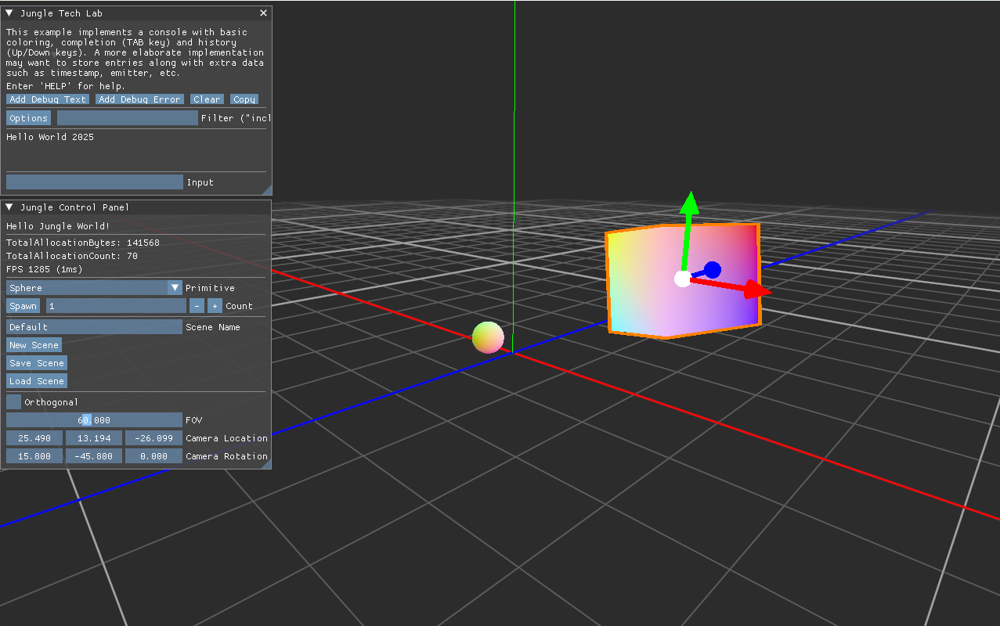
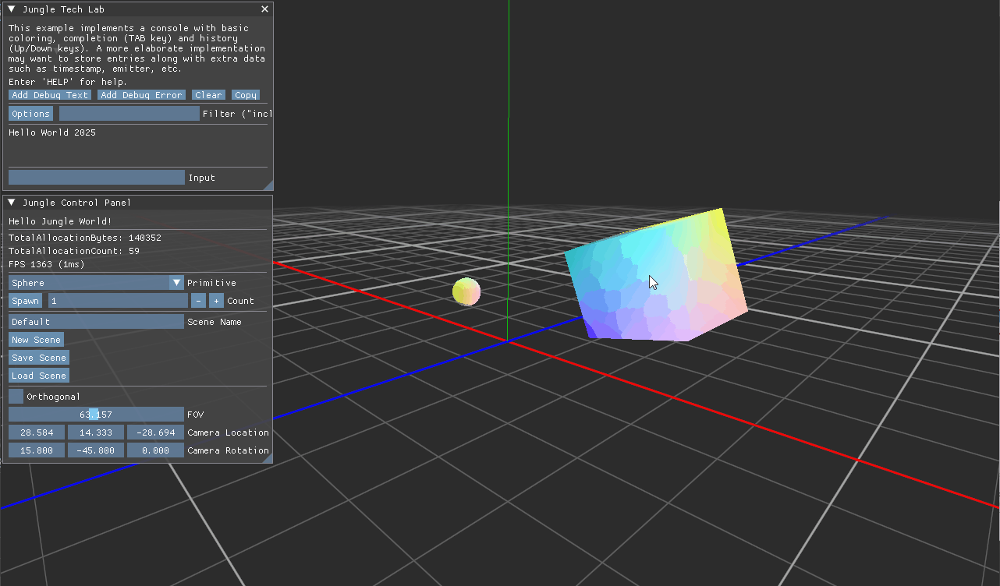

# 🧭 Week 02 — DirectX 11 3D Level Editor

> DirectX 11 렌더링 위에 객체 구조와 선택·변형 도구를 쌓아 만든 미니 3D 레벨 에디터

[← 전체 주차 보기](../README.md)

## 프로젝트 정보

- 프로젝트명: DirectX 11 3D Level Editor
- 기간: 2026.03.13. ~ 2026.03.19.
- 팀 구성: 4명
- 원본 저장소: [Week02_Team06](https://github.com/CaptainTangerine/Week02_Team06) 🔒
- 공개 프로젝트: [Week02_Team06.slnx](Week02_Team06.slnx) · [소스 및 콘텐츠](Week02_Team06/)

## 프로젝트 개요

2D 게임을 만들었던 1주차에서 한 단계 확장해, 3D 공간을 탐색하고 오브젝트를 편집할 수 있는 DirectX 11 기반 미니 레벨 에디터를 구현했습니다. 월드·레벨·액터·컴포넌트로 객체의 책임을 나누고, 메시 로딩과 렌더링, 에디터 카메라, 마우스 피킹, 이동·회전·크기 조절 기즈모, 씬 저장과 불러오기를 하나의 편집 흐름으로 연결했습니다.

객체 구조는 언리얼 엔진의 객체 모델을 참고했습니다. `UObject`를 공통 기반으로 두고 `World`, `Level`, `Actor`, `ActorComponent`, `SceneComponent`, `PrimitiveComponent`로 역할을 나눴으며, 언리얼의 `StaticClass`, `IsA`, `NewObject`와 유사한 개념을 학습 목적으로 직접 구현했습니다. 언리얼 엔진 코드를 그대로 사용한 것이 아니라 핵심 개념을 작은 엔진 구조에 맞게 재구성한 것입니다.

개인 기여는 커밋 메시지만으로 판단하지 않고 각 커밋의 변경 파일과 실제 diff를 확인해 기능 단위로 분류했습니다. 공개 문서에는 팀원의 실명이나 개별 커밋 기록을 싣지 않았습니다.

## 미리보기

### 타이틀 화면



### 에디터 조작



## 팀 전체 구현

- Win32 윈도우와 DirectX 11 디바이스·스왑 체인·렌더링 파이프라인 구성
- View·Projection 행렬을 사용하는 3D 카메라와 에디터 뷰포트 조작
- `World → Level → Actor → ActorComponent`로 이어지는 객체 구조
- JSON 메시 리소스 로딩과 큐브·삼각형·구·기즈모 렌더링
- 마우스 레이 피킹과 선택한 액터의 위치·회전·크기 편집
- 이동·회전·스케일 기즈모와 축별 드래그 처리
- 그리드, XYZ 축, 바운드, 와이어프레임, 선택 외곽선 등 디버그 시각화
- ImGui 기반 오브젝트 목록·상세 속성·생성 UI
- 씬 직렬화와 기본 씬 저장·불러오기
- 객체 생성·파괴, 커스텀 RTTI, 할당량 추적을 포함한 기반 시스템

## 개인 기여

### 객체 모델과 생성·파괴 구조

- 언리얼 엔진의 `UObject`·`Actor`·`Component` 객체 모델을 참고해 학습용 엔진 계층을 설계했습니다.
- `UObject` 전역 배열, UUID와 내부 인덱스를 도입해 엔진 객체를 일관되게 추적했습니다.
- 템플릿 기반 `NewObject`와 `DestroyObject`를 구현하고, 삭제 시 배열의 마지막 원소와 교체해 인덱스 정합성을 유지했습니다.
- `Actor`, `ActorComponent`, `SceneComponent`, `PrimitiveComponent`, `Level`, `World`의 상속·소유 관계를 구성했습니다.
- 클래스 메타데이터와 부모 클래스 정보를 이용하는 `StaticClass`, `GetClass`, `IsA` 형태의 커스텀 RTTI를 구현했습니다.
- 액터의 `RootComponent`를 기준으로 자식 씬 컴포넌트의 위치·회전·크기를 갱신하는 흐름을 정리했습니다.

### 메모리 추적과 수명 주기 정리

- 전역 `new`·`delete` 경로에서 현재 할당 바이트와 할당 횟수를 추적하는 `FMemory`를 추가했습니다.
- 객체 팩토리와 월드 종료 경로를 연결하고, 컴포넌트·컨테이너·렌더러의 해제 누락을 수정했습니다.
- 시작과 종료 시점의 메모리 통계를 로그로 비교할 수 있게 해 누수 여부를 확인했습니다.
- Release 구성에서만 드러나던 객체 정리 순서와 초기화 문제를 수정했습니다.

### 화면 좌표 기반 마우스 피킹

- 마우스 좌표를 NDC로 변환한 뒤 역 Projection·역 View 행렬을 거쳐 월드 공간의 레이를 계산했습니다.
- 레이를 각 메시의 로컬 공간으로 변환하고 Möller–Trumbore 알고리즘으로 삼각형 교차를 검사했습니다.
- 최초 충돌 액터를 바로 반환하지 않고 교차 거리 `t`를 비교해 카메라에 가장 가까운 액터를 선택하도록 개선했습니다.
- 메시의 모든 삼각형을 검사하기 전에 레이-구 교차 검사를 수행하는 broad phase를 추가해 불필요한 정점 순회를 줄였습니다.

### 기즈모와 회전 처리

- 선택 액터와 이동·회전·스케일 기즈모를 연결하고 드래그 시작점과 축 상태를 월드에서 관리했습니다.
- 이동 기즈모의 드래그 평면을 카메라 위치에 맞춰 고정해 축 조작이 튀는 현상을 줄였습니다.
- 회전 기즈모에는 Rodrigues 회전 공식을 행 벡터 방식에 맞게 적용해 축 회전 행렬을 누적했습니다.
- Euler 각을 직접 더하는 방식 대신 회전 행렬을 보존할 수 있는 경로를 추가해 연속 회전의 짐벌락 문제를 완화했습니다.

### 에디터 보조 렌더링

- 별도의 line vertex buffer와 line-list 토폴로지로 XYZ 축과 바닥 그리드를 렌더링했습니다.
- 선택된 오브젝트를 한 번 확대해 그린 뒤 원본을 다시 그리는 외곽선 패스를 구성했습니다.
- 삼각형과 일반 메시의 컬링 조건이 다른 문제를 별도의 rasterizer state로 분리해 외곽선 누락을 수정했습니다.
- 깊이 편향과 렌더 상태 복원을 조정해 그리드의 Z-fighting과 외곽선 오류를 줄였습니다.

## 문제 해결

### 메시 전체를 검사하면서 피킹 비용이 커지는 문제

초기 피킹은 모든 액터의 모든 삼각형에 대해 교차 검사를 수행했습니다. 먼저 액터의 위치와 스케일로 근사한 바운딩 스피어와 레이의 교차 여부를 검사하고, 통과한 액터에만 정밀한 삼각형 검사를 수행하도록 두 단계로 나눴습니다. 정밀 검사에서는 가장 작은 양의 교차 거리만 남겨 앞쪽 오브젝트가 선택되도록 했습니다.

### 객체 삭제 뒤 전역 배열의 인덱스가 어긋나는 문제

엔진 객체를 전역 배열로 관리하면서 중간 원소를 지우면 뒤의 모든 인덱스를 갱신해야 했습니다. 삭제 대상 자리에 마지막 객체를 옮기고 그 객체의 내부 인덱스만 수정한 뒤 배열의 끝을 제거하는 방식으로 정합성과 삭제 비용을 함께 관리했습니다.

### 축 회전을 반복할수록 방향이 예상과 달라지는 문제

Euler 각에 축별 변화량을 더하는 방식은 회전 순서의 영향을 크게 받고 연속 조작에서 짐벌락이 발생했습니다. 드래그 시작 시점의 회전을 행렬로 보존하고, 선택 축으로 만든 Rodrigues 회전 행렬을 DirectX의 행 벡터 규칙에 맞는 순서로 곱해 결과를 적용했습니다.

### 선택 외곽선이 메시 종류에 따라 사라지는 문제

확대한 메시를 front-face culling으로 그리는 일반적인 외곽선 방식이 단면 삼각형에는 그대로 적용되지 않았습니다. 삼각형에는 culling을 끈 전용 rasterizer state를 사용하고, 일반 폐곡면에는 front-face culling을 적용해 두 종류를 분리했습니다.

### 종료 시 메모리와 GPU 객체가 남는 문제

객체 팩토리, 액터 컴포넌트, 렌더러가 서로 다른 시점에 자원을 정리해 일부 포인터와 할당이 남았습니다. 전역 할당 통계를 기준으로 누락 경로를 찾고 월드·컨테이너·렌더 상태의 해제 순서를 보완했습니다.

## 코드 아카이브

```text
week02/
├── README.md
├── NOTICE.md
├── Docs/             # 에디터 화면과 조작 GIF
├── Week02_Team06.slnx
└── Week02_Team06/
    ├── Content/       # 메시 데이터, 에디터 설정, 기본 씬
    ├── ImGui/         # Dear ImGui 소스
    ├── *.cpp, *.h     # 엔진·에디터 소스
    ├── *.hlsl         # DirectX 11 셰이더
    └── *.vcxproj      # Visual Studio 프로젝트
```

원본 저장소의 최종 상태를 기준으로 IDE 캐시와 빌드 산출물을 제외한 프로젝트 소스·셰이더·콘텐츠를 보관했습니다. 에디터 화면과 실제 조작 GIF도 문서용 미리보기로 포함했습니다. 1주차와 달리 솔루션과 프로젝트 파일, 실행에 필요한 JSON 메시·기본 씬, 포함형 서드파티 소스도 함께 있어 프로젝트 구조를 그대로 열어볼 수 있습니다.

## 빌드 환경

- Windows 10/11
- Visual Studio 2022와 Desktop development with C++ 워크로드
- Windows 10 SDK
- C++20
- DirectX 11, HLSL
- Dear ImGui
- nlohmann/json 단일 헤더

`Week02_Team06.slnx`를 열고 `x64` 구성으로 빌드하는 구조입니다. 이 아카이브를 정리한 환경에서는 Visual C++ 빌드 도구와 실제 실행 화면까지 다시 검증하지 않았으므로, 실행 가능 배포본이 아니라 원본 프로젝트의 소스 스냅샷으로 봐야 합니다.

## 회고

2주차에는 화면에 3D 도형을 그리는 것보다, 생성된 객체가 누구에게 소유되고 언제 갱신·파괴되는지를 설계하는 일이 더 큰 과제였습니다. 객체 팩토리와 RTTI, 액터·컴포넌트 구조, 메모리 통계를 직접 구현하면서 에디터 기능이 엔진의 수명 주기 위에 놓인다는 점을 경험했습니다.

또한 피킹과 기즈모는 렌더링 결과를 입력으로 다시 연결하는 작업이었습니다. 좌표계 변환, 레이 교차, 드래그 평면, 행렬 곱 순서가 조금만 어긋나도 선택과 조작이 즉시 불안정해졌습니다. 넓은 단계와 정밀 단계로 피킹을 나누고, 회전 표현을 행렬로 확장하며 수학적 구현을 실제 편집 도구의 동작으로 다듬은 주차였습니다.
