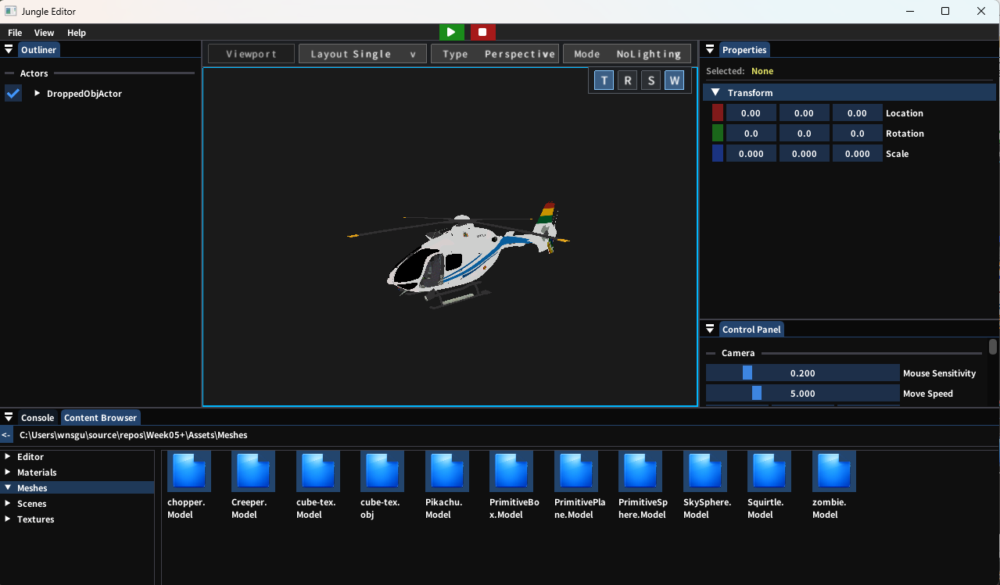
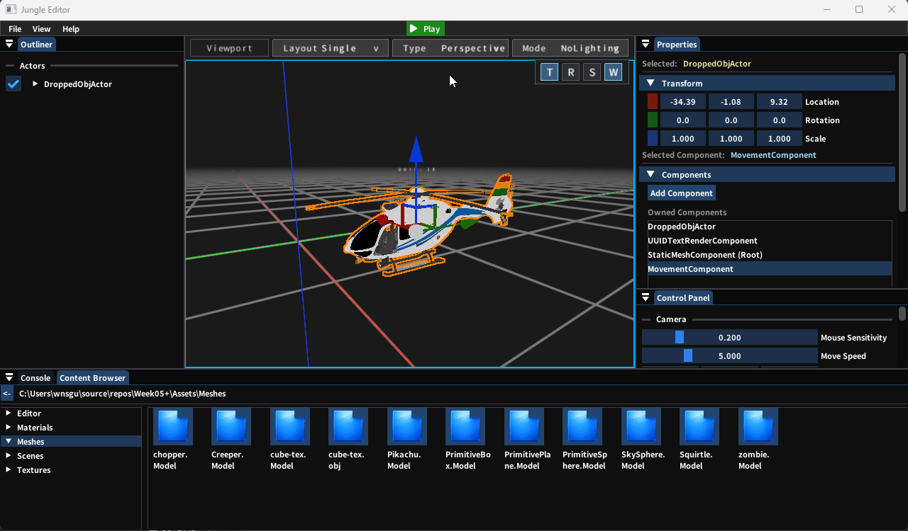

# ▶️ Week 05+ — Play In Editor & Object Duplication

> 편집 중인 월드를 깊은 복제해 원본을 보존하면서 즉시 실행하는 PIE(Play In Editor) 시스템

## 프로젝트 정보

- 프로젝트명: Jungle Engine — Week5 Plus
- 기간: 2026.04.08. ~ 2026.04.09.
- 팀 구성: 4명
- 원본 저장소: [KraftonJungle3_Week5Plus_Team8](https://github.com/CaptainTangerine/KraftonJungle3_Week5Plus_Team8)
- 공개 프로젝트: [Project](Project/) · [KraftonJungleEngine.sln](Project/KraftonJungleEngine.sln)

## 프로젝트 개요

기존 커스텀 DirectX 11 에디터에 PIE(Play In Editor)를 추가한 프로젝트입니다. 편집 중인 `Editor World`를 그대로 실행하지 않고 별도의 `PIE World`로 깊은 복제한 다음 `BeginPlay`와 런타임 Tick을 수행합니다. 플레이 중 발생한 위치·컴포넌트·런타임 상태 변경이 편집 원본에 남지 않으며, 종료하면 안전하게 Editor World로 돌아옵니다.

원본 저장소에는 이전 엔진 개발 이력이 함께 들어 있으므로, 5+ 분석은 Week5 Plus 작업이 시작된 2026년 4월 8일 이후로 범위를 분리했습니다. 개인 기여는 본인 계정과 작성자 서명을 대조하고 각 비병합 커밋의 변경 파일과 실제 diff를 확인해 정리했습니다. 공개 문서에는 팀원의 실명이나 개별 커밋 기록을 싣지 않았습니다.

## 실행 화면

### 타이틀 화면

Jungle Editor의 Outliner, Viewport, Properties, Control Panel과 Content Browser를 한 화면에서 확인할 수 있습니다.



### PIE 데모

Movement Component가 적용된 오브젝트를 선택하고 Play·Pause·Resume·Stop을 전환하면서, 복제된 PIE World에서만 런타임 동작이 진행되는 과정을 확인할 수 있습니다.



## 핵심 실행 흐름

```text
Editor World
    │ Play
    ▼
UWorld::Duplicate()
    └─ Scene → Actor → Component 순서의 깊은 복제
           ├─ 새 UUID·InternalIndex 발급
           ├─ Outer·Owner 재연결
           ├─ BeginPlay 상태 초기화
           └─ 카메라·동적 메시 등 소유 리소스 분리
    │
    ▼
PIE WorldContext 생성 → PlayerStart 카메라 배치 → BeginPlay
    │
    ├─ Pause: World Tick·카메라 입력 중지
    ├─ Resume: Tick·입력 재개
    └─ Stop: Editor World 복귀 → PIE 객체 PendingKill → GC 정리
```

## 문제 → 설계 → 해결

| 문제 | 사용한 설계 | 해결 | 추가 개선점 |
|---|---|---|---|
| Editor World를 직접 실행하면 플레이 중 변경이 편집 원본을 오염시킴 | 별도 `PIE WorldContext`와 World 깊은 복제 | 플레이 전용 월드에서만 BeginPlay·Tick을 수행하고 Stop 시 원본으로 복귀 | Undo/Redo 및 PIE 변경 사항 선택 적용 기능으로 확장 가능 |
| C++ 복사 생성자는 Actor·Component 포인터와 컨테이너를 얕게 복사함 | `Duplicate` → `PostDuplicate` → `DuplicateSubObjects` 3단계 복제 | Scene·Actor·Component 계층을 재귀 복제하고 새 Outer·Owner로 재연결 | 원본→복사본 매핑 테이블을 두면 컴포넌트 간 참조도 일반적으로 복구 가능 |
| 복제 객체가 원본 UUID·전역 배열 인덱스를 공유하면 조회와 GC가 충돌함 | Object Factory 기반 identity 재발급 | UUID와 InternalIndex를 초기화하고 전역 오브젝트 배열·UUID 맵에 새 객체로 등록 | 복제 실패 시 부분 생성 객체를 롤백하는 트랜잭션 처리 필요 |
| Camera·Text·Billboard가 내부 포인터나 GPU 리소스를 원본과 공유함 | 타입별 `DuplicateSubObjects`와 전용 복사 생성자 | Camera 인스턴스, 동적 메시와 머티리얼 상태를 새로 생성해 소유권 분리 | 모든 UObject 참조 필드를 자동 추적하는 리플렉션 복제로 발전 가능 |
| PIE 시작 위치와 방향을 정의할 기준이 없음 | `PlayerStart` Actor와 월드 forward 기반 회전 변환 | PlayerStart 위치·방향으로 카메라를 초기화하고 없으면 기존 에디터 카메라 사용 | 여러 PlayerStart 선택 정책과 Pawn spawn 흐름 추가 가능 |
| 일시정지 중에도 월드와 카메라가 움직이거나 편집 입력이 섞임 | PIE 상태 머신과 입력 라우팅 | Pause에서 World Tick과 카메라 입력을 중단하고 PIE 중 선택·기즈모·그리드를 비활성화 | Step Frame, Possess/Eject, 게임 입력 매핑 분리로 확장 가능 |
| PIE 종료 후 선택 포인터와 복제 객체가 남으면 use-after-free 위험 | Editor World 선복귀, 선택 해제, `CleanupWorld`, PendingKill·GC | 렌더/Tick 대상에서 PIE World를 먼저 제거한 뒤 객체를 정리해 댕글링 포인터 방지 | PIE 종료 스트레스 테스트와 자동 생명주기 검증 추가 필요 |

## 팀 전체 구현

- Editor World와 분리된 PIE WorldContext 및 Play·Pause·Resume·Stop 상태 전환
- `UObject` 계층의 깊은 복제와 World·Scene·Actor·Component 재귀 복제
- PlayerStart Actor, 방향 화살표와 빌보드 아이콘
- PIE 시작 위치·방향에 따른 카메라 초기화
- PIE 중 편집 전용 UUID 텍스트·PlayerStart 시각화·기즈모·그리드 비활성화
- Billboard Component와 Sprite 텍스처 선택 UI
- 선택 Component를 대상으로 한 기즈모 조작
- World BVH 구성과 디버그 라인 시각화
- 에디터 Add Component 메뉴와 Property 편집 기능 보강
- Game·PIE에서만 동작하는 Movement Component와 직렬화
- 회전 행렬·Quaternion 변환 및 PlayerStart 방향 계산 보정
- 샘플 `Week5Plus` 씬과 런타임 이동 오브젝트

## 개인 기여

### UObject 깊은 복제 기반

- 모든 RTTI 기반 UObject 파생 타입이 실제 런타임 타입을 유지하며 복제되도록 `Duplicate()`를 생성하는 공통 경로를 구성했습니다.
- 복사 직후 `PostDuplicate()`에서 원본 UUID·InternalIndex를 제거하고 새 identity를 발급해 전역 객체 배열과 UUID 맵에 등록했습니다.
- `DuplicateSubObjects()`를 계층별 확장 지점으로 두어 값 복사와 소유 객체의 재귀 복사를 분리했습니다.
- PendingKill 플래그를 복제하지 않고 플레이·등록 상태를 초기화해 새 런타임 객체처럼 시작하도록 했습니다.

### World → Scene → Actor → Component 재귀 복제

- World의 Persistent Level, Streaming Level과 Scene Camera를 새 World를 Outer로 하여 복제했습니다.
- Scene의 Actor 배열을 비우고 각 Actor를 새 Scene 소속으로 깊은 복제했습니다.
- Actor의 Component 목록과 RootComponent를 복사본으로 교체하고 Scene 캐시와 BeginPlay 상태를 재설정했습니다.
- ActorComponent의 Owner를 새 Actor에서 다시 찾고 등록·BeginPlay 상태를 초기화했습니다.
- SceneComponent의 기존 attachment 포인터를 초기화해 원본 컴포넌트를 잘못 참조하지 않도록 했습니다.

### 타입별 리소스 복제

- CameraComponent가 원본 `FCamera` 포인터를 공유하지 않도록 동일 설정의 새 카메라 인스턴스를 생성했습니다.
- Text Component가 원본 동적 메시를 공유하지 않도록 새 `FDynamicMesh`를 만들고 다음 프레임에 재구축하도록 dirty 상태를 설정했습니다.
- Billboard Component에 명시적인 복사 경로를 추가해 동적 메시와 머티리얼·텍스처 캐시를 원본과 분리했습니다.
- PIE에서 불필요한 UUID 텍스트와 에디터용 텍스트 표시를 비활성화했습니다.

### PIE 생명주기와 툴바

- Editor World를 복제하고 PIE 타입의 WorldContext로 전환한 뒤 `BeginPlay`를 호출하는 Start 흐름을 구현했습니다.
- Play·Pause·Resume·Stop 버튼을 중앙 툴바에 배치하고 상태에 따라 사용할 수 있는 동작과 색상을 구분했습니다.
- Pause 상태에서는 World Tick과 카메라 입력을 모두 중단하고 Resume 시 다시 연결했습니다.
- Stop에서 활성 컨텍스트를 Editor로 먼저 돌린 뒤 PIE 선택을 해제하고 복제 World를 Cleanup·PendingKill 처리했습니다.
- PIE 중 에디터 선택, 기즈모 조작, 단축키와 그리드 렌더링이 섞이지 않도록 입력·렌더 경로를 분리했습니다.

### PlayerStart와 PIE 카메라

- PlayerStart Actor를 추가하고 에디터에서 위치와 방향을 확인할 수 있도록 화살표·빌보드 시각화를 연결했습니다.
- PIE 시작 시 복제 월드에서 PlayerStart를 찾아 카메라 위치와 회전을 초기화했습니다.
- PlayerStart가 없으면 현재 Perspective Viewport 카메라 상태를 유지하도록 fallback을 구성했습니다.
- BeginPlay에서 PlayerStart 시각화를 숨겨 런타임 화면에 에디터 마커가 남지 않도록 했습니다.
- 빌보드 복제 오류와 PlayerStart 방향·가시성 문제를 수정했습니다.

## 복제 단계 상세

### 1. Duplicate

RTTI 매크로가 파생 타입의 복사 생성자를 호출해 실제 타입을 보존합니다. 이 시점의 포인터 멤버는 아직 원본을 가리킬 수 있으므로 완성된 복제본으로 취급하지 않습니다.

### 2. PostDuplicate

새 Outer와 이름을 적용하고 identity를 초기화합니다. Object Factory가 새 UUID와 InternalIndex를 발급하고 전역 조회 구조에 등록합니다.

### 3. DuplicateSubObjects

각 타입이 자신이 소유한 객체와 리소스를 새로 만듭니다. 상위 타입의 구현을 먼저 호출한 다음 Actor의 Component, Camera의 내부 객체, Text·Billboard의 동적 메시처럼 타입 고유 소유권을 분리합니다.

## 코드 아카이브

```text
week05+/
├── README.md
├── NOTICE.md
├── Docs/
│   └── Media/                  # 타이틀 화면·PIE 데모 GIF
└── Project/
    ├── KraftonJungleEngine.sln
    ├── Assets/                 # Scene·Model·Material·Texture
    ├── Content/                # Font·Texture·보조 콘텐츠
    ├── Engine/                 # 공용 엔진 DLL과 런타임 시스템
    ├── Editor/                 # PIE·UI·Viewport·Gizmo
    ├── Client/                 # 게임 런타임 실행기
    ├── ObjViewer/              # OBJ 검수·Model export 도구
    └── Scripts/                # 프로젝트 보조 스크립트
```

원본 저장소의 최종 Git 상태에서 빌드와 실행에 필요한 프로젝트 소스, 셰이더, 씬과 에셋을 보관했습니다. 약 9천 개·100MB 규모의 자동 생성 Doxygen HTML/LaTeX 문서, NuGet 복원 폴더, IDE 캐시와 빌드 산출물은 제외했습니다.

## 빌드와 실행

- Windows 10/11 x64
- Visual Studio 2022와 Desktop development with C++ 워크로드
- Windows 10 SDK, MSVC v143
- C++20
- DirectX 11 지원 GPU

Developer PowerShell에서 다음 순서로 빌드할 수 있습니다.

```powershell
msbuild .\Project\KraftonJungleEngine.sln /t:Restore /p:RestorePackagesConfig=true
msbuild .\Project\Engine\Engine.vcxproj /p:Configuration=Debug /p:Platform=x64
msbuild .\Project\Editor\Editor.vcxproj /p:Configuration=Debug /p:Platform=x64
msbuild .\Project\Client\Client.vcxproj /p:Configuration=Debug /p:Platform=x64
msbuild .\Project\ObjViewer\ObjViewer.vcxproj /p:Configuration=Debug /p:Platform=x64
.\Project\Editor\Bin\Debug\Editor.exe
```

Engine을 먼저 빌드한 뒤 나머지 실행 대상을 빌드해야 합니다. 현재 솔루션에서 ObjViewer의 Engine 프로젝트 의존성이 명시되지 않아, 깨끗한 상태에서 `/m` 병렬 전체 빌드를 실행하면 ObjViewer가 먼저 링크되면서 `Engine.lib`를 찾지 못할 수 있습니다.

## 기술 스택

- C++20
- DirectX 11, HLSL
- Win32 API
- Dear ImGui와 자체 Slate형 UI
- DirectX Tool Kit for DirectX 11
- Visual Studio 2022, MSVC v143

## 검증과 제한 사항

- 5+ 시작 범위를 분리하고 본인 GitHub 계정과 작성자 서명을 대조했습니다.
- 개인 기여로 분류한 각 비병합 커밋의 변경 파일과 실제 diff를 확인했습니다.
- 병합 및 다른 계정의 작업은 개인 기여에서 제외했습니다.
- 공개 문서에서 팀원 실명과 개별 커밋 식별 정보는 제외했습니다.
- NuGet 복원 후 Engine·Editor·Client·ObjViewer `Debug | x64` 빌드를 확인했습니다.
- Editor 실행 파일이 시작 후 10초간 정상 실행 상태를 유지하는 것을 확인했습니다.
- 빌드에는 정수·부동소수점 축소 변환 관련 기존 컴파일러 경고가 남아 있습니다.
- DirectXTK 패키지 복원 시 중간 심각도의 알려진 보안 취약점 경고가 확인돼 외부 배포 전 의존성 업데이트가 필요합니다.
- SceneComponent attachment는 복제 시 원본 참조를 끊지만 복제본끼리 자동 재연결하지 않습니다. 범용 복제를 위해서는 원본→복제본 remap 단계가 추가로 필요합니다.
- 실행 검증은 에디터 시작 스모크 테스트이며 Play·Pause·Resume·Stop 전체를 자동화한 테스트는 포함하지 않습니다.

## 회고

5+에서는 복사가 단순한 값 복사가 아니라 객체의 identity와 소유권, 생명주기를 다시 만드는 작업이라는 점을 경험했습니다. World 하나를 복제하려면 Scene·Actor·Component뿐 아니라 UUID, Outer, Owner, BeginPlay 상태와 카메라·동적 메시 같은 내부 리소스까지 원본과 분리해야 했습니다.

PIE 종료 과정 역시 생성만큼 중요했습니다. 렌더와 Tick이 참조하는 활성 World를 먼저 원본으로 돌리고, 선택 포인터를 제거한 뒤 복제 객체를 GC 대상으로 넘겨야 안전했습니다. 이를 통해 에디터 기능은 화면의 Play 버튼 하나가 아니라 복제·입력 라우팅·상태 전환·리소스 수명 관리가 결합된 시스템이라는 점을 배웠습니다.
