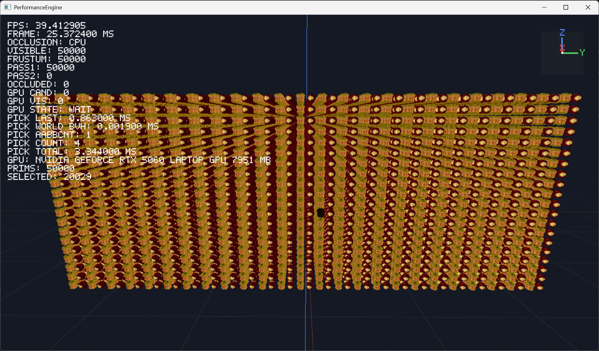
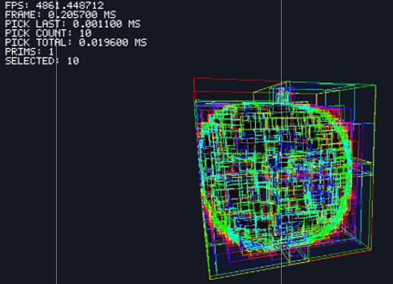
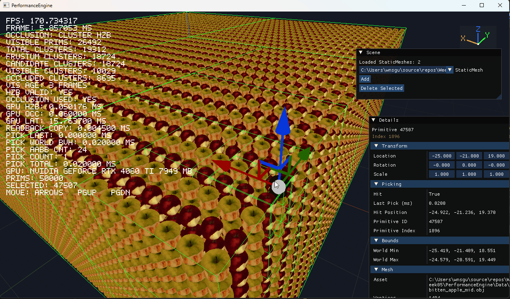

# ⚡ Week 05 — Picking Optimization Contest

> 5만 개 오브젝트를 대상으로 동적 SAH BVH를 설계해 피킹 병목을 줄인 DirectX 11 성능 최적화 프로젝트



[← 전체 주차 보기](../README.md)

## 프로젝트 정보

- 프로젝트명: Performance Engine — Picking Optimization Contest
- 기간: 2026.04.03. ~ 2026.04.09.
- 팀 구성: 4명
- 원본 저장소: [W05_Team8](https://github.com/DDing-Ho-Archive/W05_Team8)
- 공개 프로젝트: [Project](Project/) · [PerformanceEngine.sln](Project/PerformanceEngine.sln)

## 프로젝트 개요

표준 씬과 메시가 바뀔 수 있고, 배치된 오브젝트가 실시간으로 이동하는 조건에서 FPS와 피킹 시간을 함께 겨루는 콘테스트였습니다. 모든 오브젝트와 삼각형을 순차 검사하던 피킹 경로를 월드 오브젝트 BVH와 메시 내부 삼각형 BVH의 2단계 구조로 바꾸고, AABB에서 후보를 좁힌 뒤 리프에서만 Möller–Trumbore 교차 검사를 수행했습니다.

개인 기여는 본인 계정과 작성자 서명을 대조하고 각 비병합 커밋의 변경 파일과 diff를 확인해 정리했습니다. 공개 문서에는 팀원의 실명이나 개별 커밋 기록을 싣지 않았습니다.

## 실행 화면

### BVH 디버그 시각화

메시와 오브젝트를 감싸는 BVH AABB 계층을 색상별 와이어프레임으로 확인할 수 있습니다.



### 5만 개 오브젝트 피킹과 동적 편집

대규모 오브젝트 장면에서 BVH 피킹 결과와 성능 수치를 확인하고, 선택한 오브젝트를 기즈모로 이동하는 실행 장면입니다.



## 왜 BVH를 선택했는가

콘테스트의 씬은 오브젝트 수와 메시가 바뀌고, 오브젝트의 크기도 균일하지 않으며, 런타임 중 이동·추가·삭제가 일어날 수 있었습니다. 고정된 공간 셀을 사용하는 구조는 큰 오브젝트가 여러 셀에 걸치거나 한 영역에 오브젝트가 몰릴 때 효율이 급격히 떨어질 수 있습니다. BVH는 각 노드가 실제 오브젝트의 AABB를 감싸므로 크기가 불균일한 데이터에 적응하고, 레이와 만나지 않는 계층 전체를 빠르게 제외할 수 있습니다.

또한 BVH는 동적 상황에도 대응할 수 있습니다. 이동이 작으면 상위 AABB만 `refit`하고, 기존 여유 경계를 벗어난 오브젝트만 제거 후 적절한 위치에 재삽입할 수 있습니다. 추가·삭제도 해당 리프와 조상 경로만 갱신하면 되므로 매 변경마다 전체 트리를 재구축할 필요가 없습니다. 이 특성 때문에 정적 피킹 속도뿐 아니라 콘테스트 이후의 편집·동적 씬까지 고려해 BVH를 선택했습니다.

## 문제 → 알고리즘 → 해결 → 개선

| 문제 | 사용한 알고리즘 | 해결 | 개선 사항 |
|---|---|---|---|
| 모든 오브젝트와 삼각형을 선형 순회해 5만 개에서 피킹 시간이 급증 | World AABB BVH + Local Triangle BVH + 리프의 Möller–Trumbore | 월드 BVH에서 오브젝트 후보를 줄이고, 로컬 BVH에서 삼각형 후보를 다시 줄여 실제 삼각형 검사를 최소화 | 가까운 자식 우선 순회, 현재 최단 거리보다 먼 노드 가지치기, 고정 배열 스택으로 순회 비용 절감 |
| 초기 BVH가 가장 긴 축의 공간 중앙을 기준으로 단순히 절반 분할되어, 크기와 분포가 불균일한 장면에서 AABB 중첩이 커짐 | SAH(Surface Area Heuristic) | 세 축의 삼각형 중심을 분할 후보로 평가하고 `왼쪽 면적×개수 + 오른쪽 면적×개수`가 가장 작은 축과 위치를 선택 | 분할하지 않은 비용인 `현재 면적×개수`보다 이득이 없으면 리프로 남겨 불필요한 분할을 중단 |
| 모든 후보를 평가하는 SAH는 좋은 트리를 만들지만 빌드 시간이 길어짐 | 비용 기반 휴리스틱과 조기 종료 | 표면적과 primitive 수를 순회 비용의 근사치로 사용해 이득 없는 하위 분할을 생략 | 향후 고정 개수 bin을 사용하는 Binned SAH를 적용하면 트리 품질을 유지하면서 빌드 비용을 더 줄일 수 있음 |
| 오브젝트 이동·추가·삭제 때 전체 BVH를 다시 만들면 동적 씬 비용이 커짐 | Dynamic BVH, SAH 기반 best-sibling 탐색, refit/reinsert | 우선순위 큐와 비용 하한으로 삽입할 형제 노드를 찾고, 추가·삭제 후 조상 AABB만 refit | 이동은 Loose AABB 내부면 refit만 수행하고, 경계를 벗어날 때만 remove/insert하여 재구성 빈도 축소 |
| BVH 순회 중 같은 레이 계산과 불필요한 노드 방문이 반복됨 | inverse direction 캐시, near-first traversal, distance pruning | 레이 방향 역수를 한 번만 계산하고 가까운 노드를 먼저 방문해 조기에 최단 거리를 확보 | SIMD 적용도 실험했으나 실제 구조와 비용 대비 이득을 검토해 되돌리고, 검증된 스칼라 경로를 유지 |

## 알고리즘 발전 과정

### 1. 가장 긴 축의 중앙 분할

첫 구현은 노드 AABB에서 가장 긴 축을 고르고 공간의 정확한 중앙을 pivot으로 삼았습니다. 구현과 빌드는 빠르지만 primitive가 한쪽에 몰리거나 크기가 서로 다르면 자식 AABB가 겹치고 트리가 불균형해져 순회 노드 수가 늘어났습니다.

### 2. SAH 분할

각 노드에서 X·Y·Z축의 모든 삼각형 중심을 후보 pivot으로 검사하고 다음 비용이 가장 작은 분할을 선택했습니다.

```text
Cost = LeftSurfaceArea × LeftPrimitiveCount
     + RightSurfaceArea × RightPrimitiveCount
```

표면적이 작고 primitive 수가 적은 자식이 만들어지도록 유도해 레이가 방문할 가능성이 높은 영역의 비용을 낮췄습니다. 기존 노드를 그대로 리프로 두는 비용과도 비교해, 분할 이득이 없는 경우 재귀를 종료했습니다.

### 3. 휴리스틱으로 빌드 비용 제어

모든 중심 후보를 다시 순회하는 정확한 SAH 평가는 노드당 비용이 커서 트리 생성 시간이 길어졌습니다. 프로젝트에서는 `표면적 × primitive 수`를 예상 순회 비용으로 사용하는 휴리스틱과 조기 종료를 적용했고, 동적 삽입에서는 우선순위 큐로 낮은 비용 후보부터 살펴보며 하한 비용이 현재 최선보다 큰 가지를 제외했습니다. 완전 탐색의 품질을 최대한 유지하면서 불필요한 계산과 분할을 줄이는 방향입니다.

### 4. 동적 BVH

- 추가: 새 AABB와 결합했을 때 SAH 비용 증가가 작은 형제 노드를 찾아 리프를 삽입합니다.
- 삭제: 리프와 부모를 제거하고 형제를 조부모 위치로 올린 뒤 상위 AABB를 refit합니다.
- 이동: 10% 여유를 둔 Loose AABB 안에서는 리프와 조상만 갱신하고, 밖으로 나가면 제거 후 재삽입합니다.
- 메모리: 삭제한 노드 인덱스를 free list에 보관해 다음 삽입에서 재사용합니다.

## 성능 결과

### 측정 환경

- 빌드 구성: `Release | x64`
- CPU: Intel® Core™ i7-14700 (2.10 GHz)
- RAM: 32.0 GB

| 비교 | 이전 | 이후 | 개선 |
|---|---:|---:|---:|
| 5만 개 오브젝트 선형 Möller–Trumbore 검사 → BVH 피킹 | 5,847.65 ms | 0.2568 ms | 약 **22,771배** 빠름 |
| 중앙 분할 BVH → SAH BVH | 1.221 ms | 0.37 ms | 약 **3.30배** 빠름, 시간 약 **69.7% 감소** |

Release 환경에서 5만 개 오브젝트를 대상으로 측정했으며, `5,847.65 ÷ 0.2568` 기준 약 22,771배의 피킹 성능 향상을 확인했습니다. 비교의 핵심은 Möller–Trumbore 알고리즘 자체를 없앤 것이 아니라, BVH로 실제 삼각형 교차 검사를 수행할 후보 수를 크게 줄였다는 점입니다.

## 팀 전체 구현

- 5만 개 오브젝트 표준 씬과 FPS·프레임·피킹 시간 계측 HUD
- OBJ 정점 중복 제거, 인덱스 버퍼와 머티리얼 섹션 처리
- 월드 BVH와 메시 로컬 BVH 기반 2단계 피킹
- BVH 방문 노드와 AABB 디버그 시각화
- 실시간 프러스텀 컬링과 가시성 처리
- 런타임 씬 데이터의 hot/cold 분리와 렌더 제출 경로 최적화
- 정적·동적 오브젝트를 분리한 visibility cluster
- 비동기 2-pass HZB 오클루전 컬링
- QEM 기반 LOD와 전역 재구축을 줄인 local update
- 선택 오브젝트 이동·추가·삭제, transform gizmo와 로컬 BVH 피킹
- 프레임·피킹 이벤트를 CSV와 summary로 저장하는 벤치마크 로깅

## 개인 기여

### 메시 로컬 BVH 피킹

- 정적 메시의 삼각형과 중심점, AABB를 이용해 로컬 공간 BVH를 빌드했습니다.
- 월드 레이를 오브젝트 로컬 공간으로 변환하고 AABB 계층을 통과한 리프에서만 삼각형 교차를 검사했습니다.
- 인덱스 버퍼 기반 메시를 올바르게 참조하도록 삼각형 인덱싱을 수정했습니다.
- 후면 컬링 조건을 바로잡아 잘못된 면이 선택되거나 정상 면이 누락되는 문제를 해결했습니다.

### SAH와 순회 최적화

- 가장 긴 축 중앙 분할을 세 축의 모든 중심 후보를 평가하는 SAH 분할로 개선했습니다.
- 가까운 자식을 먼저 순회하고 현재 최단 hit보다 먼 AABB를 제외하도록 가지치기를 추가했습니다.
- 힙 기반 컨테이너 대신 고정 크기 배열 스택을 사용해 순회 중 할당을 제거했습니다.
- AABB 교차마다 반복하던 레이 방향 역수 계산을 피킹 레이당 한 번으로 캐시했습니다.
- 로컬 SIMD 적용을 실험한 뒤 최종 경로에서는 되돌려 안정적인 스칼라 구현을 유지했습니다.

### 동적 월드 BVH

- SAH 비용 증가가 작은 형제를 찾는 동적 리프 삽입과 조상 refit 경로를 다듬었습니다.
- 오브젝트 추가·삭제 시 BVH 노드와 render item 인덱스가 어긋나는 문제를 수정했습니다.
- 작은 이동은 refit, 큰 이동은 remove/reinsert로 처리하는 Dynamic BVH 갱신을 정리했습니다.
- 삭제 노드 재사용, 루트 교체와 부모·형제 연결 갱신을 보강했습니다.

### 편집 입력 안정화

- 더블클릭으로 피킹이 중복 처리되는 입력 문제를 수정했습니다.
- ImGui Property 창이 활성화된 상태에서 카메라 잠금과 입력 전달이 충돌하는 문제를 해결했습니다.

## 코드 아카이브

```text
week05/
├── README.md
├── NOTICE.md
├── Docs/
│   └── Media/                      # BVH 디버그 화면·실행 GIF
└── Project/
    ├── PerformanceEngine.sln
    ├── Docs/                       # 과제 자료와 결과 화면
    └── PerformanceEngine/
        ├── Data/                   # 표준 씬·OBJ·MTL·텍스처
        ├── Shader/                 # HLSL 셰이더
        ├── Source/
        │   ├── BVH/                # 로컬 BVH 빌드·디버그
        │   ├── Picking/            # 월드/로컬 BVH 순회
        │   ├── Scene/              # 동적 BVH와 씬 데이터
        │   ├── Visibility/         # 프러스텀·오클루전 가시성
        │   └── Renderer/           # DirectX 11 렌더링
        └── PerformanceEngine.vcxproj
```

원본 저장소의 최종 Git 상태에서 솔루션, 프로젝트 소스, 셰이더, 문서와 실행 에셋을 보관했습니다. NuGet 복원 폴더, IDE 캐시와 빌드 산출물은 포함하지 않았습니다.

## 빌드와 실행

- Windows 10/11
- Visual Studio 2022와 Desktop development with C++ 워크로드
- Windows 10 SDK, MSVC v143
- C++20, AVX2
- DirectX 11 지원 GPU

Visual Studio에서 `Project/PerformanceEngine.sln`을 열고 NuGet 패키지를 복원한 뒤 `Release | x64`로 빌드합니다. Developer PowerShell에서는 다음과 같이 실행할 수 있습니다.

```powershell
msbuild .\Project\PerformanceEngine.sln /t:Restore /p:RestorePackagesConfig=true
msbuild .\Project\PerformanceEngine.sln /m /p:Configuration=Release /p:Platform=x64
.\Project\Bin\Release\PerformanceEngine.exe
```

최종 소스는 Visual Studio 2022의 `Release | x64` 구성으로 경고와 오류 없이 빌드됐고, 생성된 프로그램이 시작 후 정상적으로 실행 상태를 유지하는 것을 확인했습니다.

## 기술 스택

- C++20
- DirectX 11, HLSL
- Win32 API
- Dear ImGui
- DirectX Tool Kit for DirectX 11
- Visual Studio 2022, MSVC v143

## 회고

5주차에는 교차 판정 수학 자체보다 “무엇과 교차 판정을 할 것인가”를 먼저 줄이는 공간 자료구조가 성능을 지배한다는 점을 확인했습니다. BVH로 후보를 계층적으로 제거한 뒤 리프에서만 Möller–Trumbore를 수행하면서, 수천 밀리초였던 선형 검사를 서브 밀리초 수준으로 낮출 수 있었습니다.

동시에 좋은 트리를 만드는 비용도 무시할 수 없었습니다. 단순 중앙 분할은 빠르게 만들 수 있지만 데이터 분포에 취약했고, SAH는 순회 품질을 높이는 대신 빌드 시간이 늘었습니다. 표면적 비용 휴리스틱, 조기 종료, 동적 refit과 선택적 재삽입을 조합하면서 빌드·순회·갱신 비용 사이의 균형을 설계하는 경험을 얻었습니다.
