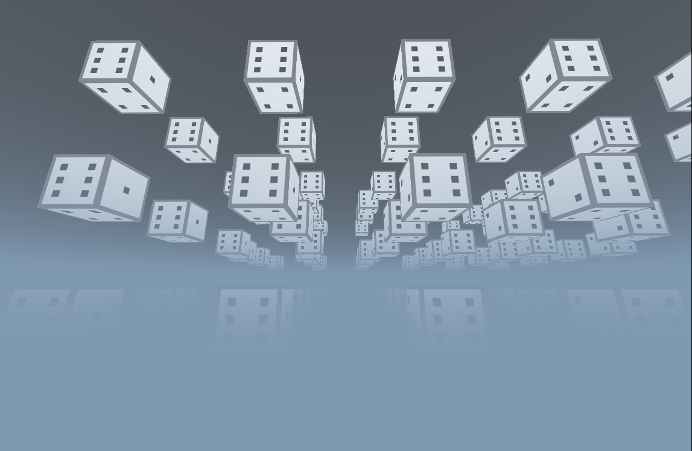
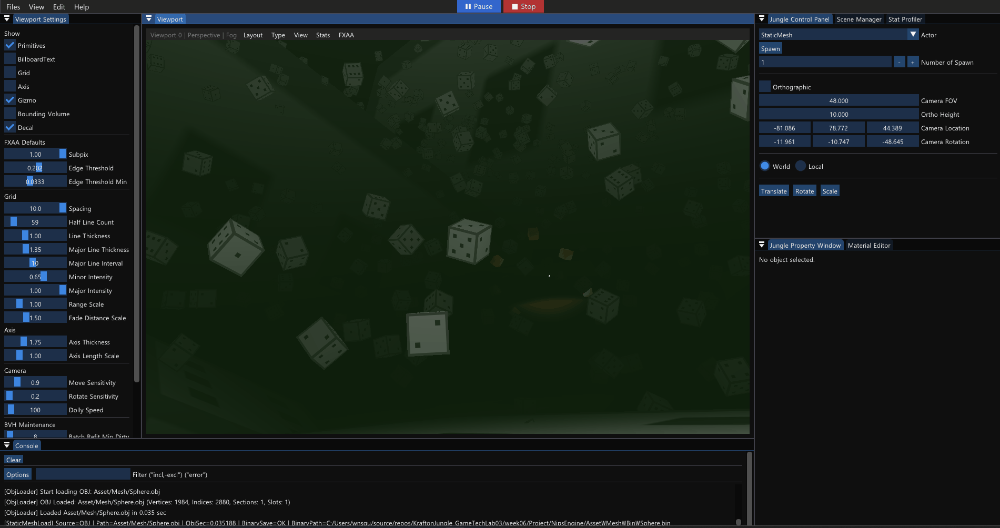

# 🌫️ Week 06 — Scene Depth & Exponential Height Fog

> 공유 SceneDepth를 기반으로 Decal·Fireball·안개·FXAA를 확장한 DirectX 11 렌더링 프로젝트

## 프로젝트 정보

- 프로젝트명: NipsEngine — Screen-space Effects
- 기간: 2026.04.11. ~ 2026.04.16.
- 팀 구성: 4명
- 원본 저장소: [KraftonJungle_Week6_Team5](https://github.com/DKael/KraftonJungle_Week6_Team5)
- 공개 프로젝트: [Project](Project/) · [NipsEngine.sln](Project/NipsEngine.sln)

## 프로젝트 개요

이전 주차의 커스텀 DirectX 11 에디터를 확장해, 한 번 생성한 SceneDepth를 여러 화면 공간 효과가 공유하도록 렌더 경로를 구성한 프로젝트입니다. Depth View, Decal, Fireball, Exponential Height Fog가 같은 깊이 자원을 사용하며, 4분할 뷰포트마다 깊이 텍스처의 올바른 영역을 읽도록 UV offset과 scale을 전달합니다. 뷰포트별 FXAA, 픽셀 셰이더 기반 무한 그리드, 씬 저장·복원과 데모 씬도 함께 구현했습니다.

원본 저장소에는 이전 엔진 개발 이력이 함께 들어 있으므로, 6주차 분석은 새 렌더링 기능이 시작된 2026년 4월 11일 이후로 범위를 분리했습니다. 개인 기여는 본인 계정과 작성자 서명을 대조하고 각 비병합 커밋의 변경 파일과 실제 diff를 확인해 정리했습니다. 공개 문서에는 팀원의 실명이나 개별 커밋 기록을 싣지 않았습니다.

## 실행 화면

### 타이틀 화면

서로 다른 높이에 배치된 주사위 오브젝트에 Exponential Height Fog가 적용되어, 카메라에서 멀어지고 기준 높이에 가까워질수록 안개가 짙어지는 장면입니다.



### Fog 데모

에디터의 Fog View Mode에서 주사위 장면을 이동하며 높이와 거리에 따른 안개 밀도 변화를 확인하는 실행 데모입니다.



## 렌더링 흐름

```text
Geometry Depth Prepass
        │
        ▼
공유 SceneDepth Texture
        │ ViewportUVOffset · ViewportUVScale
        ├─ Depth View      : 선형화한 깊이 시각화
        ├─ Decal           : 깊이로 월드 위치 복원 → OBB 내부 투영
        ├─ Fireball        : 깊이 비교 기반 교차 효과
        └─ Height Fog      : 월드 위치 복원 → 높이별 밀도 적분
                                  │
                                  ▼
                         Viewport별 FXAA 후처리
```

## 문제 → 설계 → 해결

| 문제 | 사용한 설계 | 해결 | 추가 개선점 |
|---|---|---|---|
| 4분할 뷰포트가 하나의 깊이 텍스처를 공유하면 각 화면이 전체 텍스처를 잘못 샘플링함 | D3D11 Viewport에서 UV offset·scale을 계산하는 `SceneDepthBuffer` | 현재 뷰포트의 local UV를 공유 텍스처 좌표로 변환해 Depth·Decal·Fireball·Fog가 같은 깊이를 정확히 사용 | 뷰포트별 독립 렌더 타깃을 지원한다면 자원 수명과 resize 정책도 함께 추상화 가능 |
| 거리만으로 안개를 섞으면 높이에 따른 대기 밀도 변화가 표현되지 않음 | Exponential Height Fog의 레이 구간 밀도 적분 | SceneDepth와 inverse view-projection으로 월드 위치를 복원하고 카메라에서 표면까지의 밀도를 적분 | 여러 Fog Volume과 방향광 산란, 색상 그라데이션으로 확장 가능 |
| 직교 카메라와 하늘 픽셀에는 일반 원근 깊이 복원 방식이 맞지 않음 | 카메라별 inverse view-projection과 far-plane 방향 fallback | 원근·직교 뷰에서 같은 복원 경로를 사용하고, 깊이가 1인 픽셀은 cutoff 거리까지 안개를 계산 | 역행렬과 ray origin을 뷰 타입별로 명시하면 직교 카메라의 물리적 정확도를 더 높일 수 있음 |
| 수평에 가까운 레이에서는 지수 적분식의 분모가 0에 가까워지고 큰 지수는 overflow를 일으킴 | epsilon 분기, 상수 밀도 근사, 지수 입력 clamp | 수평 레이는 별도 식으로 계산하고 exponent 범위를 제한해 NaN·Inf와 화면 깜빡임을 방지 | 극단적인 카메라 높이·밀도 조합을 자동 검증하는 셰이더 테스트 추가 필요 |
| 여러 화면 공간 효과가 상수 버퍼 슬롯을 겹쳐 사용하면 잘못된 데이터가 셰이더에 전달됨 | 효과별 버퍼 역할과 register 재배치 | Decal·Fireball·Fog·SceneDepth의 슬롯을 분리하고 각 패스 직전에 필요한 상수를 갱신 | C++과 HLSL의 register 정의를 공통 메타데이터에서 생성하면 수동 불일치 방지 가능 |
| 안개 파라미터를 코드에서만 바꾸면 장면별 튜닝과 재사용이 어려움 | `AExponentialHeightFog`와 `UHeightFogComponent`, Property UI와 씬 직렬화 | 색상·밀도·높이 감쇠·시작 거리·최대 거리·최대 불투명도를 에디터에서 조정하고 저장 | 현재 첫 번째 활성 Fog만 사용하는 정책을 우선순위·블렌딩 방식으로 발전 가능 |

## 팀 전체 구현

- 공유 SceneDepth 생성, 뷰포트별 깊이 좌표 변환과 Depth View 시각화
- 깊이 복원 기반 Screen-space Decal, OBB 경계·fade·z-fighting 보정
- Decal 다중 머티리얼과 씬 저장·복원
- Exponential Height Fog Actor·Component·렌더 패스와 전용 View Mode
- Fake Spotlight, Fake Light와 원통형 Billboard 표현
- Fireball Component·Shader, 투사체 이동과 회전 Movement Component
- 투명·가산 블렌딩과 Fireball AABB·에디터 선택 처리
- 뷰포트별 활성화와 파라미터 설정을 지원하는 FXAA
- 픽셀 셰이더 기반 무한 Grid와 카메라 거리에 따른 표시 보정
- 에디터 View Mode·Show Flag·통계 UI 확장
- 씬 저장·로드 안정화와 기능 확인용 데모 씬

## 개인 기여

### 다중 뷰포트 SceneDepth 보정

- Depth View가 4분할 화면에서 전체 깊이 텍스처를 읽던 문제를 분석하고, 현재 D3D11 viewport의 `TopLeft`, `Width`, `Height`를 텍스처 크기에 대한 UV offset·scale로 변환했습니다.
- SceneDepth 상수 버퍼를 Depth·Decal·Fireball·Fog 셰이더가 공통으로 사용하도록 렌더 리소스와 갱신 경로를 정리했습니다.
- 픽셀 셰이더에서 local viewport UV를 공유 깊이 텍스처 좌표로 변환해 각 뷰포트가 자신의 영역만 샘플링하도록 수정했습니다.

### Exponential Height Fog 객체 모델

- `AExponentialHeightFog` Actor와 `UHeightFogComponent`를 추가하고 기존 Actor–Component–Render Collector 구조에 통합했습니다.
- Fog Color, Density, Height Falloff, Start Distance, Cutoff Distance, Max Opacity를 Property로 노출했습니다.
- 새 World 생성 시 기본 Fog Actor를 배치하고, Fog View Mode를 에디터 툴바·뷰포트 오버레이·ObjViewer 제어 UI에 연결했습니다.
- Fog 파라미터의 복제와 Scene 저장·로드 경로를 보강해 에디터에서 조정한 결과가 유지되도록 했습니다.

### 깊이 복원과 높이 안개 셰이더

- SceneDepth와 inverse view-projection으로 픽셀의 월드 위치를 복원하고 카메라부터 표면까지의 시선 벡터를 계산했습니다.
- 기준 높이에서 멀어질수록 밀도가 지수적으로 감소하는 함수를 레이 구간에 적분해 높이와 거리를 함께 반영했습니다.
- 수평 레이에는 상수 밀도 근사를 사용하고 지수 입력을 제한해 0 나눗셈, overflow와 NaN을 방지했습니다.
- 깊이가 없는 하늘 픽셀은 far-plane 방향과 cutoff 거리를 사용하고, 시작 거리·최대 거리·최대 불투명도를 최종 transmittance에 적용했습니다.

### 카메라·버퍼·색상 경계 조건 수정

- 직교 뷰포트에서도 Fog 위치 복원이 일관되도록 카메라 행렬 전달과 셰이더 경로를 수정했습니다.
- 안개 색을 엔진의 `LinearColor` Property 체계로 바꾸고 색상 편집 UI·직렬화에 연결했습니다.
- Fog·Fireball·Decal·SceneDepth 상수 버퍼의 register 충돌을 해소하고 렌더 패스별 데이터 갱신 순서를 정리했습니다.
- Height Fog 계산 코드를 적분 함수와 픽셀 합성 단계로 분리해 수치 안정성과 가독성을 높였습니다.

## 코드 아카이브

```text
week06/
├── README.md
├── NOTICE.md
├── Docs/
│   └── Media/                      # 타이틀 화면·Fog 실행 GIF
└── Project/
    ├── NipsEngine.sln
    ├── ReleaseBuild.bat
    ├── Scripts/                    # 프로젝트 파일 생성 도구와 내장 Python
    └── NipsEngine/
        ├── Asset/                  # Scene·Mesh·Texture·Font
        ├── Settings/               # Editor·ObjViewer 설정
        ├── Shaders/                # Depth·Decal·Fog·Fireball·FXAA HLSL
        ├── Source/                 # Engine·Editor·ObjViewer 코드
        ├── ThirdParty/             # Dear ImGui 등 포함형 코드
        ├── packages.config
        └── NipsEngine.vcxproj
```

원본 저장소의 최종 Git 상태에서 추적 중인 456개 파일을 그대로 보관했습니다. Git 이력, NuGet 복원 폴더, IDE 캐시와 빌드 산출물은 포함하지 않았습니다.

## 빌드와 실행

- Windows 10/11 x64
- Visual Studio 2022와 Desktop development with C++ 워크로드
- Windows 10 SDK, MSVC v143
- C++20
- DirectX 11 지원 GPU

Developer PowerShell에서 다음 순서로 빌드할 수 있습니다.

```powershell
msbuild .\Project\NipsEngine.sln /t:Restore /p:RestorePackagesConfig=true /p:Configuration=Release /p:Platform=x64
msbuild .\Project\NipsEngine.sln /m /p:Configuration=Release /p:Platform=x64

Push-Location .\Project\NipsEngine
.\Bin\Release\NipsEngine.exe
Pop-Location
```

프로그램은 `NipsEngine` 폴더를 작업 디렉터리로 사용해야 상대 경로의 Shader·Asset·Settings를 찾을 수 있습니다. `Project/ReleaseBuild.bat`을 실행하면 실행 파일과 런타임 리소스를 `Project/ReleaseBuild`에 모은 배포 폴더를 만들 수 있습니다.

## 기술 스택

- C++20
- DirectX 11, HLSL
- Win32 API
- Dear ImGui와 자체 Slate형 UI
- DirectX Tool Kit for DirectX 11
- Visual Studio 2022, MSVC v143

## 회고

6주차에는 화면 공간 효과가 개별 셰이더 하나로 끝나는 기능이 아니라는 점을 경험했습니다. 깊이 텍스처의 생성 시점, 뷰포트 좌표계, 카메라 역행렬, 상수 버퍼 슬롯과 렌더 패스 순서가 모두 맞아야 Decal과 Fog가 같은 장면을 올바르게 해석할 수 있었습니다.

특히 높이 안개를 구현하면서 그래픽 수식은 정상적인 입력뿐 아니라 수평 레이, 하늘 픽셀, 직교 카메라와 매우 큰 지수처럼 실제 렌더링에서 나타나는 경계 조건까지 포함해야 한다는 점을 배웠습니다. 수학적 모델을 엔진 객체, 에디터 Property, 직렬화와 다중 뷰포트 렌더링까지 연결하며 하나의 기능을 도구와 런타임 전체에 통합하는 과정을 익혔습니다.
