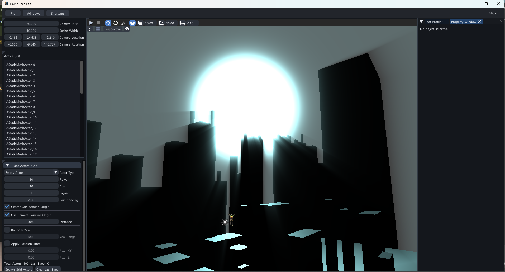
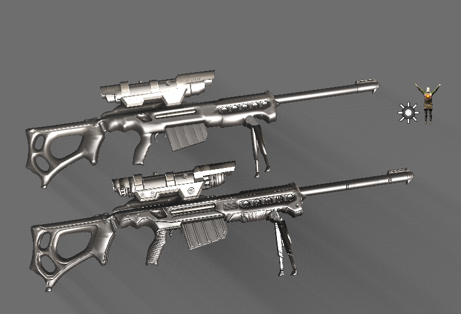

# ☀️ Week 07 — Normal Mapping, Uber Shader & Screen-space God Ray

> DirectX 11 엔진에서 표면의 굴곡과 화면 공간 광선을 표현한 렌더링 작업

## 프로젝트 정보

- 프로젝트명: KraftonEngine — Week 07
- 팀 구성: 4명
- 원본: 보존된 `week07.zip` (기존 팀 저장소 삭제)
- 공개 프로젝트: [Project](Project/) · [KraftonEngine.sln](Project/KraftonEngine.sln)

## 프로젝트 개요

제가 담당한 범위는 **노멀 맵, 우버 셰이더, 스크린 스페이스 갓레이**입니다. 노멀 맵으로 메시의 픽셀별 법선을 바꾸고, 우버 셰이더의 변형을 통해 조명 모델과 노멀 맵 사용 여부를 조합했습니다. 갓레이는 화면에서 태양이 가려지는 영역을 깊이로 판별한 뒤 광선의 퍼짐을 후처리로 합성합니다.

팀 저장소의 Git 이력은 남아 있지 않습니다. 아래 기술 내용은 보존된 최종 소스와 제공해주신 작업 범위를 기준으로 작성했으며, 개별 커밋이나 다른 기능의 구현자를 추정하지 않았습니다.

## 실행 화면

### 타이틀 1 — 스크린 스페이스 갓레이

건물 실루엣 사이로 태양 광선이 퍼지는 장면입니다.



### 타이틀 2 — 노멀 맵

두 모델의 표면에서 노멀 맵으로 표현한 음영과 세부 질감을 확인할 수 있습니다.



### 갓레이 GIF 데모

에디터에서 광원과 카메라의 위치가 바뀔 때 가려진 영역을 따라 광선이 변하는 실행 장면입니다.


## 개인 기여

### 노멀 맵

- 노멀 텍스처의 RGB를 탄젠트 공간 법선 `[-1, 1]`로 복원하고, 메시의 탄젠트와 정규 직교화한 법선으로 TBN 기저를 구성했습니다.
- TBN으로 변환한 법선을 픽셀별 조명 계산에 전달해 모델의 기하를 늘리지 않고 표면의 굴곡을 표현했습니다.
- 메시 섹션에 노멀 텍스처가 있을 때 해당 셰이더 변형과 텍스처 SRV를 선택하도록 연결했습니다.

### 우버 셰이더

- 하나의 `UberLit.hlsl`에서 Gouraud, Lambert, Blinn–Phong, BRDF, Toon 조명 경로를 컴파일 정의로 선택하도록 구성했습니다.
- 조명 모델과 노멀 맵 유무를 변형 키로 조합하고, 필요한 변형을 시작 시 준비해 렌더링 중 해당 셰이더를 선택하도록 했습니다.
- 노멀 맵 적용 경로를 조명 계산과 깊이·법선 출력 경로에 연결했습니다.

### 스크린 스페이스 갓레이

- Directional Light의 방향을 화면상의 태양 위치로 변환하고, 역 Z SceneDepth로 가림 물체를 판별해 별도의 오클루전 텍스처를 만들었습니다.
- 태양 위치를 중심으로 256회 방사형 샘플을 누적하고, 감쇠·가중치·노출·강도와 광원 색상을 적용했습니다.
- 후처리 결과를 가산 블렌딩으로 장면에 합성하고 뷰포트 설정에서 태양 반경과 효과 파라미터를 조절하도록 연결했습니다.

## 문제 → 구현 → 결과

| 문제 | 구현 | 결과 |
|---|---|---|
| 기하 법선만으로는 작은 요철을 표현하기 어려움 | 탄젠트 공간 노멀 맵과 TBN 변환 | 픽셀 단위로 표면의 조명 반응이 달라짐 |
| 조명 방식과 노멀 맵 유무마다 셰이더를 따로 유지하기 어려움 | 컴파일 정의와 변형 키를 사용하는 우버 셰이더 | 공통 경로에서 필요한 조합을 선택 |
| 화면 전체에 광선을 더하면 물체 뒤의 빛도 나타남 | SceneDepth 기반 태양 가림 마스크와 방사형 누적 | 실루엣에 따라 끊어지는 광선 표현 |

## 코드 아카이브

```text
week07/
├── README.md
├── NOTICE.md
├── Docs/Media/                 # 타이틀 2장과 GIF 데모
└── Project/
    ├── KraftonEngine.sln
    ├── Scripts/
    └── KraftonEngine/
        ├── Asset/              # 씬·머티리얼·메시 캐시
        ├── Data/               # 원본 모델과 텍스처
        ├── Settings/
        ├── Shaders/            # UberLit·GodRay·GodRayOcclusion
        ├── Source/
        ├── ThirdParty/
        └── KraftonEngine.vcxproj
```

`week07.zip`의 최종 프로젝트 파일 580개를 보존했습니다. 압축 파일에는 `.git`과 빌드된 엔진 실행 파일이 없으므로 Git 히스토리는 복구되지 않으며, 실행 파일은 소스에서 다시 빌드해야 합니다.

## 빌드와 실행

Windows 10/11, Visual Studio 2022의 C++ 개발 도구, MSVC v143, Windows SDK와 DirectX 11 지원 GPU가 필요합니다. Developer PowerShell에서 `week07` 폴더로 이동한 뒤:

```powershell
msbuild .\Project\KraftonEngine.sln /t:Restore /p:RestorePackagesConfig=true /p:Configuration=Release /p:Platform=x64
msbuild .\Project\KraftonEngine.sln /m /p:Configuration=Release /p:Platform=x64
Push-Location .\Project\KraftonEngine
.\Bin\Release\KraftonEngine.exe
Pop-Location
```

`KraftonEngine` 폴더를 작업 디렉터리로 사용해야 상대 경로의 셰이더와 에셋을 찾을 수 있습니다. 보존된 압축 파일을 별도로 풀어 DirectXTK를 복원한 뒤 `Release | x64` 빌드에 성공했고, 생성된 프로그램이 10초 동안 실행 상태를 유지하는 것을 확인했습니다. 이는 프로그램 시작 검증이며 GIF의 모든 동작을 자동 검증한 것은 아닙니다. 복원 과정에서 DirectXTK 패키지의 `NU1902` 보안 경고와 기존 C++ 숫자 변환 경고가 표시됐습니다.

## 회고

노멀 맵과 우버 셰이더를 연결하면서 텍스처의 법선 표현, 메시의 탄젠트 기저, 조명 모델 선택이 하나의 픽셀 계산으로 이어지는 과정을 다뤘습니다. 갓레이에서는 빛의 퍼짐뿐 아니라 깊이로 가림을 먼저 계산해야 장면의 구조에 맞는 광선을 표현할 수 있다는 점을 확인했습니다.
