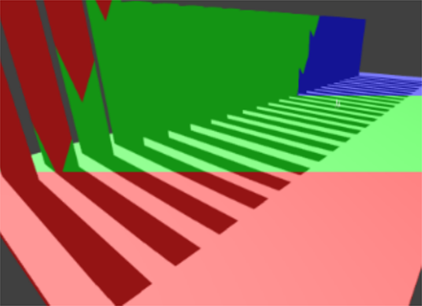
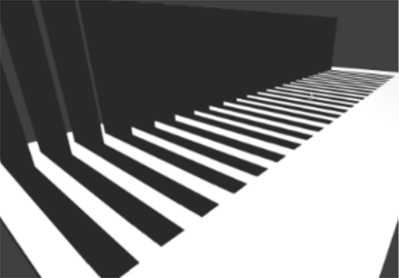

# 🌗 Week 08 — Real-time Shadow Mapping

> DirectX 11 엔진에 CSM·PSM·Point Light 그림자와 PCF·VSM 필터링을 통합한 프로젝트

[← 전체 주차 보기](../README.md)

## 프로젝트 정보

- 프로젝트명: NipsEngine — Shadow System
- 작업 기간: 2026.04.24. ~ 2026.05.02. (원본 이력 기준)
- 팀 구성: 4명
- 원본 저장소: [W8_Team6_Engine](https://github.com/puter2712git/W8_Team6_Engine)
- 공개 프로젝트: [Project](Project/) · [NipsEngine.sln](Project/NipsEngine.sln)

## 프로젝트 개요

이전 주차의 조명 엔진을 이어받아 광원이 장면에 실시간 그림자를 투영하도록 확장했습니다. Directional Light에는 카메라 거리에 따라 그림자 영역을 나누는 CSM과 PSM을, Point Light에는 6방향 큐브맵 그림자를 적용했습니다. Shadow Atlas로 여러 광원의 리소스를 관리하고 PCF·VSM으로 그림자 경계를 부드럽게 처리했습니다.

원본의 8주차 작업이 집중된 4월 24일 이후의 커밋과 변경 파일·diff, 최종 소스 및 `FEATURE_GUIDE.md`를 대조했습니다. 개인 기여는 본인 계정의 비병합 커밋에서 확인된 구현으로 한정했습니다.

## 타이틀 화면

CSM 적용 결과와 캐스케이드별 그림자 영역 시각화 화면입니다.





## 팀 전체 구현

- 광원별 Shadow Map 생성과 Shadow Atlas 타일 할당·해제
- Directional Light의 기본 그림자, CSM과 PSM
- Point Light의 6면 `TextureCubeArray` 그림자
- PCF 비교 샘플링과 VSM 모먼트·블러 기반 소프트 섀도
- 그림자 해상도 티어, 동적 크기, Light Property·직렬화
- Shadow Show Flag, 캐스케이드·아틀라스·조명 통계 시각화
- 셰이더 런타임 컴파일과 리소스·메모리 관리 보강

## 개인 기여

### 기본 그림자와 기법 선택

- Shadow Map 렌더 패스와 광원 데이터가 조명 셰이더에 전달되는 경로를 구성했습니다.
- Basic·PSM·CSM 모드를 분기하고 Cast Shadow가 꺼진 경우의 경로를 수정했습니다.
- UberLit 셰이더의 그림자 계산을 함수로 분리해 기법별 처리를 정리했습니다.

### Cascaded Shadow Maps

- Directional Light의 가시 범위를 최대 4개 캐스케이드로 분할하고 각 구간의 광원 행렬과 Atlas 영역을 계산했습니다.
- 초기 로그 분할을 선형·로그 분할을 보간하는 Practical Split으로 바꿔 근거리와 원거리의 해상도 배분을 조절했습니다.
- `CSMMaxDistance`와 분할 보간 계수를 광원 속성으로 노출하고 렌더 패스에 연결했습니다.
- 캐스케이드 경계에서 인접 구간의 그림자 결과를 블렌딩하고 캐스케이드별 색상 시각화를 추가했습니다.

### Bias와 안정성

- 표면 각도에 따른 shadow acne를 줄이기 위해 slope-scaled bias를 추가했습니다.
- C++ 상수 버퍼와 Shadow Pass, UberLit·ShadowFunction 셰이더의 bias 값을 맞췄습니다.
- Cast Shadow 비활성화 시 셰이더 컴파일 오류와 그림자 데이터 접근 문제를 수정했습니다.

## 문제 → 알고리즘 → 해결 → 개선

| 문제 | 사용한 방법 | 해결 | 개선 방향 |
|---|---|---|---|
| 단일 Shadow Map이 넓은 범위를 덮으면 근거리 그림자가 흐려짐 | 4단계 CSM | 카메라 거리별 투영과 Atlas 타일로 근거리 해상도 확보 | 캐스케이드별 해상도·갱신 주기 적응화 |
| 균등 분할은 근거리에 부족하고 로그 분할은 원거리 배분이 치우침 | Practical Split | 선형·로그 분할을 Lambda로 보간하고 최대 그림자 거리 조절 | 장면 깊이 분포 기반 자동 분할 |
| 캐스케이드 경계에서 그림자 값이 갑자기 바뀜 | 인접 캐스케이드 블렌딩 | 경계 영역의 두 결과를 보간 | 텍셀 스냅으로 움직임에 따른 흔들림 완화 |
| 고정 bias는 표면 기울기에 따라 acne와 뜬 그림자 사이의 타협이 어려움 | slope-scaled bias | 깊이 변화량에 맞춰 비교 bias 조절 | 광원·해상도별 자동 보정 |
| 여러 광원과 필터링이 큰 리소스를 요구함 | Shadow Atlas·큐브맵 배열, PCF·VSM | 그림자 타일과 Point Light 큐브맵을 공용 구조에서 관리 | 타일 단편화와 갱신 비용 계측 |

## 코드 아카이브

```text
week08/
├── README.md
├── NOTICE.md
└── Project/
    ├── NipsEngine.sln
    ├── FEATURE_GUIDE.md
    ├── NipsEngine/
    │   ├── Asset/             # 씬·메시·텍스처
    │   ├── Settings/
    │   ├── Shaders/           # Shadow·UberLit·VSM
    │   ├── Source/            # Engine·Editor·ObjViewer
    │   └── NipsEngine.vcxproj
    └── Scripts/
```

원본 최종 커밋의 파일 가운데 현재 Git에서 추적하는 880개를 보관했습니다. Git 이력과 빌드 산출물은 포함하지 않습니다. OBJ 모델 16개는 원본 Git LFS 데이터가 없어 공개 아카이브에서 제외했습니다. 이 모델을 사용하는 씬의 실행에는 원본 Git LFS 데이터가 필요합니다.

## 빌드와 실행

Windows 10/11, Visual Studio 2022 C++ 워크로드, Windows SDK, MSVC v143과 DirectX 11 GPU가 필요합니다. Developer PowerShell에서 `week08` 폴더를 기준으로 실행합니다.

```powershell
msbuild .\Project\NipsEngine.sln /t:Restore /p:RestorePackagesConfig=true /p:Configuration=Release /p:Platform=x64
msbuild .\Project\NipsEngine.sln /m /p:Configuration=Release /p:Platform=x64
Push-Location .\Project\NipsEngine
.\Bin\Release\NipsEngine.exe
Pop-Location
```

프로그램은 `NipsEngine`을 작업 디렉터리로 사용해야 상대 경로의 셰이더·에셋을 찾습니다.

## 회고

그림자는 Shadow Map 한 장을 그리는 것에서 끝나지 않았습니다. 카메라 범위 분할, 광원별 투영, Atlas 자원 배치, 샘플 필터와 셰이더 상수의 관계를 함께 설계해야 했습니다. CSM 분할과 경계 블렌딩, 기울기 기반 bias를 차례로 다듬으며 품질과 안정성을 조율했습니다.
