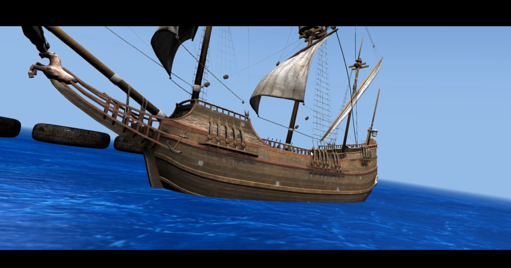

# 🚢 Week 09 — Drift Salvage 게임잼

> 배를 조종해 표류물을 모으고 장애물을 피해 등대에 도착하는 게임을 4인 팀으로 제작했습니다.

## 프로젝트 정보

- 프로젝트명: Drift Salvage
- 작업 기간: 2026.05.01. ~ 2026.05.07. (게임잼 관련 원본 이력 기준)
- 팀 구성: 4명
- 원본 저장소: [Jungle_Week9_Team4](https://github.com/deepBeom/Jungle_Week9_Team4)
- 공개 프로젝트: [Project](Project/) · [NipsEngine.sln](Project/NipsEngine.sln)

## 타이틀 화면



## 데모


## 프로젝트 개요

앞선 주차에 만든 DirectX 11 엔진을 게임 실행에 활용했습니다. 배를 이동시키며 표류물을 수집하고, 바위와 위험물의 충돌·폭발을 피하면서 등대에 도착하는 흐름을 구현했습니다. 게임잼 기간에 엔진의 이벤트, UI, 사운드, 카메라와 화면 연출 기능도 게임플레이에 맞게 확장했습니다.

원본 저장소에는 이전 주차 엔진 개발 이력이 함께 있습니다. 아래 개인 기여는 5월 1일 이후 본인 계정의 비병합 커밋에서 변경 파일과 실제 diff를 확인한 내용으로 한정했습니다. 다른 팀원의 작업과 팀 전체 결과는 별도로 적었습니다.

## 팀 전체 구현

- 배 조작과 이동, 표류물 수집, 적재량·체력 관리
- 바위·위험물 충돌, 폭발과 주변 오브젝트의 밀림·연쇄 반응
- 등대 도착 목표와 시작·종료 장면, 게임 오버 및 재시작 흐름
- Lua 스크립트 기반 게임 로직, HUD·카메라·사운드 연동

## 개인 기여

### 델리게이트와 객체 수명 관리

- **단일 델리게이트와 멀티캐스트 델리게이트**를 구현했습니다. 함수·람다 및 `UObject` 멤버 함수를 등록하며, 단일 델리게이트는 `Bind`/`UnBind`, 멀티캐스트는 `Add`/핸들 기반 `Remove`와 `Broadcast`를 제공합니다.
- 델리게이트 선언 매크로를 추가하고, 충돌 컴포넌트의 Begin/End Overlap 및 Hit 이벤트가 델리게이트를 통해 전달되도록 연결·시험했습니다.
- 객체가 삭제된 뒤 등록된 콜백이 남는 문제에 대응하기 위해 UUID 기반 `TWeakObjectPtr`를 추가했습니다. 멀티캐스트의 `UObject` 콜백은 대상이 없으면 건너뛰고, 단일 델리게이트는 잘못된 실행을 Debug assert로 탐지합니다.

### 게임 UI와 기록

- 이미지·텍스트·진행 바를 계층 구조로 관리하는 `UIManager`, 버텍스를 묶어 그리는 `UIBatcher`, UI 전용 Render Pass와 셰이더를 구성했습니다.
- UI 생성과 클릭·호버 이벤트를 Lua에 노출해 타이틀, 게임 화면, 기록판, 게임 오버 화면을 연결했습니다. 체력 애니메이션, 적재량 진행 바, 조타 휠, 카운트다운을 HUD에 표시했습니다.
- 배 기준 상대 위치와 회전으로 주변 오브젝트를 배치하고 등대 방향을 화면 가장자리에 유지하는 미니맵을 만들었습니다.
- 완주 시간 상위 3개를 정렬해 로컬 파일에 저장·불러오는 기록 기능을 구현했습니다.

### FMOD 사운드

- FMOD 기반 `SoundManager`를 추가해 BGM과 효과음의 로딩·재생·정지·볼륨 조절을 구현했습니다. BGM은 스트리밍·반복 재생하고 효과음은 메모리에서 재생합니다.
- UI와 게임 상황에 맞는 메뉴·게임 BGM, 수집·충돌·카운트다운·파도 등의 효과음을 연결하고 재시작 시 사운드 상태를 정리했습니다.

### 카메라·화면 연출과 게임 흐름

- 전체 화면 후처리 패스에 Fade, Letterbox, Gamma Correction, Vignette를 연결하고 카메라 제어와 Lua 바인딩을 추가했습니다.
- 시작 카메라 컷신과 플레이어 카메라 전환, 배 침몰 시 게임 오버 연출, 페이드 후 재시작 흐름을 구성했습니다.
- `FloatingMovementComponent`를 게임 오브젝트와 배 이동에 적용하며 이동·돛 컬링 문제를 수정했고, 재시작 과정의 크래시도 해결했습니다.

## 문제 → 적용 방법 → 결과 → 개선 방향

| 문제 | 적용 방법 | 결과 | 개선 방향 |
|---|---|---|---|
| 충돌과 UI 이벤트를 여러 시스템에 직접 연결하면 호출 관계가 복잡해짐 | 단일·멀티캐스트 델리게이트와 핸들 | 이벤트 발생 지점과 처리 함수를 분리하고 리스너 등록·해제 가능 | 등록 해제 시점과 이벤트 순서에 대한 자동 검증 |
| 삭제된 객체의 멤버 함수가 이벤트에 남을 수 있음 | UUID 기반 약한 참조 | 멀티캐스트에서 소멸한 대상 호출을 건너뛰고 단일 호출 오류를 조기 탐지 | 단일 델리게이트도 안전한 실패 결과를 반환하도록 개선 |
| 게임 화면별 UI를 엔진 코드에 고정하면 반복 수정이 느림 | UI 배칭·Render Pass·Lua 바인딩 | 타이틀부터 기록판·게임 오버까지 화면 흐름을 스크립트로 조정 | UI 요소의 수명과 Lua 콜백 정리 자동화 |
| 화면 전환과 재시작에서 영상·소리·게임 상태가 어긋남 | 화면 후처리, 카메라 블렌드, FMOD 상태 정리 | 인트로·침몰·재시작 연출을 연결하고 재시작 크래시 수정 | 전환 상태를 명시적 상태 머신으로 통합 |

## 코드 아카이브

```text
week09/
├── README.md
├── NOTICE.md
├── Docs/Media/week09-0.png  # 타이틀 화면
├── Docs/Media/week09.gif  # 게임플레이 데모
└── Project/
    ├── NipsEngine.sln
    ├── NipsEngine/
    │   ├── Asset/            # 게임 씬·Lua·모델·텍스처·사운드
    │   ├── Shaders/          # UI·화면 효과 셰이더
    │   ├── Source/           # 엔진·게임·에디터
    │   └── ThirdParty/       # FMOD 등 외부 의존성
    └── Scripts/
```

원본 `main` 최종 시점의 추적 파일 1,088개를 보관했습니다. OBJ 모델 29개는 Git LFS 원본을 받아 포함했습니다. 원본 저장소의 전체 Git 이력과 빌드 산출물은 아카이브에 포함하지 않습니다.

## 빌드와 실행

Windows 10/11, Visual Studio 2022 C++ 워크로드, Windows SDK, MSVC v143 및 DirectX 11 GPU가 필요합니다. `Project`에서 `Release | x64`로 솔루션을 빌드한 뒤 `NipsEngine`을 작업 디렉터리로 실행해야 상대 경로의 셰이더와 에셋을 찾을 수 있습니다.

### 에디터 실행

`Release | x64`는 `WITH_EDITOR=1`로 빌드되므로 에디터를 실행합니다. 에디터의 Play 버튼은 PIE입니다.

```powershell
msbuild .\Project\NipsEngine.sln /t:Restore /p:RestorePackagesConfig=true /p:Configuration=Release /p:Platform=x64
msbuild .\Project\NipsEngine.sln /m /p:Configuration=Release /p:Platform=x64
Push-Location .\Project\NipsEngine
.\Bin\Release\NipsEngine.exe
Pop-Location
```

이 환경의 병렬 빌드에서 PDB 관리자 오류 `C1902`가 나타났을 때는 x64 MSBuild로 단일 작업 빌드를 실행했습니다.

```powershell
$env:_CL_ = '/Z7'
& 'C:\Program Files\Microsoft Visual Studio\2022\Community\MSBuild\Current\Bin\amd64\MSBuild.exe' .\Project\NipsEngine.sln /m:1 /p:Configuration=Release /p:Platform=x64 /p:MultiProcessorCompilation=false
Remove-Item Env:\_CL_
```

### GameMode 단독 실행

Visual Studio의 솔루션 구성을 **`Shipping | x64`**로 선택해 빌드합니다. 이 구성은 `WITH_EDITOR=0`으로 `UGameEngine`을 생성하며 `Asset/Scene/Scene_Game.Scene`을 로드합니다. 별도의 명령행 옵션은 없습니다. 실행 파일은 `Project/NipsEngine/Bin/Shipping/NipsEngine.exe`이고, 작업 디렉터리는 `Project/NipsEngine`으로 설정합니다.

## 회고

게임잼에서는 엔진 기능을 게임 흐름에 맞게 연결하는 일이 중요했습니다. 델리게이트와 약한 참조로 이벤트와 객체 수명을 다루고, UI·사운드·카메라 연출을 Lua 게임 로직에 노출하며 짧은 기간에 화면과 플레이 경험을 반복해서 다듬었습니다.
